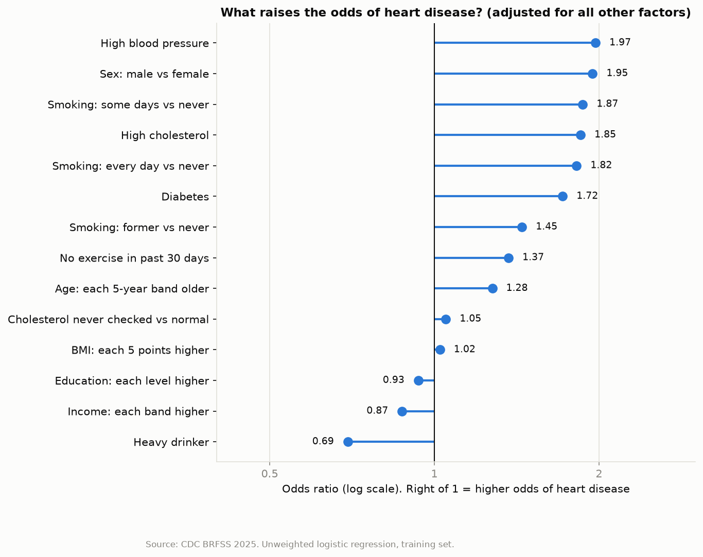
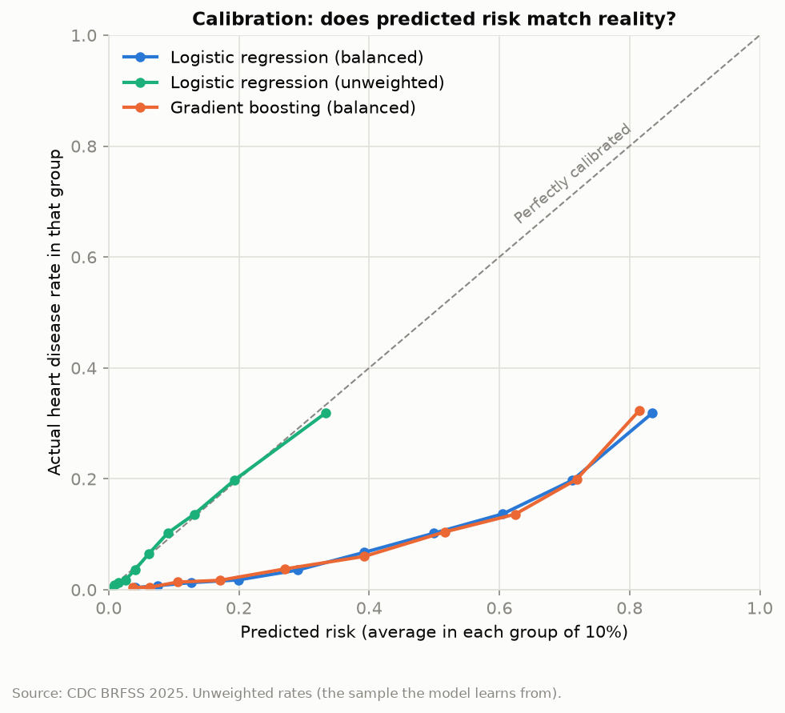
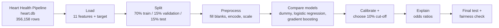

# Heart Disease Risk Model

A machine learning model in **Python** and **scikit-learn** that estimates a person's probability of having heart disease from 11 common risk factors, trained on the CDC's 2025 health survey of **352,145 US adults**.

**[▶ Try the live app](https://heart-disease-risk-oma.streamlit.app/)**: enter your details and see the model's estimated risk, and what's driving it.

It builds on my [Heart Health Pipeline](https://github.com/omathestudio/heart-health-pipeline), which turns the raw survey file into clean data. This project takes that clean data and turns it into a predictive model.

**Headline result:** on **52,822 people the model had never seen**, it ranks risk correctly 81% of the time (ROC-AUC **0.81**), catches **3 in 4** people with heart disease at a 10% risk cut-off, and its predicted risks match reality to within **0.1 percentage points**.



> **Not a diagnostic tool.** This is a portfolio and learning project built on self-reported survey data. It shows how risk factors relate to heart disease. It must not be used to make medical decisions.

---

## Results at a glance

Final model: **logistic regression**, scored once on a locked test set.

| Metric | Result | What it means |
|---|---|---|
| ROC-AUC | **0.809** | Given one person with heart disease and one without, the model gives the higher risk to the right person 81% of the time (0.5 = coin flip) |
| PR-AUC | **0.277** | 3 times better than random (0.090) at finding true cases |
| Recall at 10% cut-off | **74.8%** | Share of heart disease cases the model flags |
| Precision at 10% cut-off | **21.0%** | Share of flagged people who have heart disease, 2.3 times the average rate |
| Brier score | **0.073** | How close predicted risks are to reality (lower is better) |
| Average predicted risk | **8.9%** | Real rate in the test set: **9.0%** |

Validation and test results were almost identical (ROC-AUC 0.814 vs 0.809), so the model wasn't over-fitted to the choices made while building it.

---

## Key findings

### 1. Age, blood pressure, sex, cholesterol, smoking and diabetes drive risk

Odds ratios from the final model. Each one is **adjusted**: it measures one factor with all the others held equal.

| Factor | Odds ratio |
|---|---|
| High blood pressure | **1.97** |
| Sex: male vs female | **1.95** |
| Smoking: some days vs never | 1.87 |
| High cholesterol | **1.85** |
| Smoking: every day vs never | 1.82 |
| Diabetes | **1.72** |
| Smoking: former vs never | 1.45 |
| No exercise in past 30 days | 1.37 |
| Age: each 5-year band older | 1.28 |
| Cholesterol never checked vs normal | 1.05 |
| BMI: each 5 points higher | 1.02 |
| Education: each level higher | 0.93 |
| Income: each band higher | 0.87 |
| Heavy drinker | 0.69 |

An odds ratio of 2 doubles the odds of heart disease. Below 1 lowers them.

**What this shows:**

- **Age is the strongest factor by far, even though its number looks modest.** 1.28 is *per 5-year band*, and it compounds. Going from 18–24 to 80+ is 12 bands, so 1.28¹² ≈ **19 times the odds**. No other factor comes close.
- **The classic cardiovascular risk factors each roughly double the odds.** Hypertension and high cholesterol drive atherosclerosis, diabetes damages the lining of blood vessels, and men lose the protective effect oestrogen gives women before menopause.
- **Quitting smoking helps, but risk doesn't fully return to baseline.** Former smokers (1.45) sit between current smokers (about 1.8) and people who never smoked.
- **BMI has almost no effect once other factors are included (1.02).** That doesn't mean weight doesn't matter. It means BMI acts largely *through* blood pressure, cholesterol and diabetes, which are already in the model. This is called **mediation**.
- **Income and education are protective**, reflecting the well-known socioeconomic gradient in heart disease.
- **Heavy drinking appears protective (0.69), but it isn't.** People diagnosed with heart disease are often told to stop drinking, so they're missing from the heavy-drinker group (the "sick quitter" effect). This is reverse causation, not a benefit of alcohol.

<!-- Oma: add 1-2 sentences of your own physiology commentary here, e.g. anything that surprised you or links to your degree. -->

**Adjusted vs unadjusted.** In the [pipeline](https://github.com/omathestudio/heart-health-pipeline), people with diabetes had a heart disease rate of 19.3% vs 5.0% without, a gap of nearly 4 times. Adjusted for everything else, the odds ratio is 1.72. Much of the simple gap came from age: people with diabetes are older on average. The same happens with "cholesterol never checked". These people had half the average rate (4.5%), but adjusted for age that difference disappears (1.05), because they're mostly younger.

### 2. The simple model was as good as the complex one

| Model | ROC-AUC | PR-AUC | Recall | Accuracy |
|---|---|---|---|---|
| Dummy (always predicts the average) | 0.500 | 0.090 | 0.000 | **0.910** |
| Logistic regression | 0.814 | 0.285 | 0.791 | 0.702 |
| Gradient boosting | 0.817 | 0.289 | 0.809 | 0.692 |

*Validation set. Recall and accuracy at a 50% cut-off with balanced class weights.*

- **Accuracy is misleading here.** The dummy model scores 91% accuracy by predicting "no heart disease" for everyone, and catches no cases at all. That's why this project uses ROC-AUC, PR-AUC and recall.
- **Gradient boosting gained only 0.003 AUC over logistic regression.** With 11 self-reported features, a more flexible model has little extra to find. I chose logistic regression because it performs the same, trains faster, and every feature has an odds ratio a clinician can read.

### 3. The predicted risks can be taken at face value



| Model | ROC-AUC | Brier score | Average predicted risk |
|---|---|---|---|
| Logistic regression (balanced weights) | 0.814 | 0.185 | 37.8% |
| **Logistic regression (unweighted)** | **0.814** | **0.072** | **9.1%** |
| Gradient boosting (balanced weights) | 0.817 | 0.184 | 37.1% |

*Validation set. Real heart disease rate: 9.0%.*

A common fix for rare outcomes is to weight the rare cases more heavily ("balanced" class weights). It didn't improve ranking here at all (0.814 either way), but it pushed every predicted risk up about four times. Without the weights, the model's "15% risk" really means about 15%. I then chose the cut-off for "high risk" on purpose, instead of using 50% by default.

**Choosing the cut-off.** Catching more cases means flagging more people:

| Cut-off | Cases caught | Flagged people who have it | Share of everyone flagged |
|---|---|---|---|
| 7.5% | 84% | 19% | 40% |
| **10%** | **75%** | **21%** | **32%** |
| 15% | 60% | 25% | 21% |

I chose **10%**: it catches 3 in 4 cases while flagging about a third of people. For context, UK NICE guidance uses a 10% risk threshold for offering statins. That's a *10-year risk of a future event*, though, while this model estimates the chance someone *already has* heart disease, so the two aren't equivalent.

### 4. Fair risk scores, but one cut-off doesn't serve every group equally

Test set results by group:

| Group | People | Real rate | Predicted risk | ROC-AUC | Cases caught |
|---|---|---|---|---|---|
| Women | 27,912 | 7.2% | 7.0% | 0.792 | **63.3%** |
| Men | 24,910 | 11.0% | 11.0% | 0.813 | **83.2%** |
| Age 18–44 | 15,774 | 1.5% | 1.4% | 0.741 | **5.6%** |
| Age 45–64 | 15,446 | 6.9% | 6.6% | 0.788 | 55.6% |
| Age 65+ | 20,596 | 16.4% | 16.5% | 0.699 | **86.1%** |
| Income under $35k | 10,658 | 13.6% | 13.2% | 0.770 | 82.6% |
| Income $35k–$100k | 18,378 | 9.0% | 9.0% | 0.798 | 73.3% |
| Income $100k+ | 13,251 | 5.4% | 5.3% | 0.837 | 62.4% |

*Full table, including education, in `results/fairness.csv`.*

- **The risk scores are honest for every group.** Average predicted risk matches the real rate in every row, so a "15% risk" means the same thing whoever you are.
- **Ranking is fairly even** across sex, income and education (AUC 0.77–0.84). It's lower within age bands, which is expected: age is the strongest predictor, so it explains less once everyone in a group is a similar age.
- **The single 10% cut-off catches far fewer cases among women (63% vs 83% for men) and adults under 45 (6% vs 86% for over-65s).** Their average risk is lower, so even those with heart disease rarely score above 10%. This mirrors a real problem in clinical practice: heart disease in women and younger adults is under-recognised. A model trained on the population picks up the same pattern.

Possible responses include group-specific cut-offs (which raise their own ethical questions) or showing the risk score itself rather than a yes/no flag. I report this as a limitation rather than hiding it.

---

## How it works



| Step | File | What it does |
|---|---|---|
| Settings | `src/config.py` | Data path, target, features, excluded columns and why, the 10% cut-off |
| Load | `src/data.py` | Reads the pipeline's SQLite database and drops rows with no heart disease answer |
| Check | `src/check_data.py` | Class balance and missing values |
| Explore | `src/explore.py` | Charts: are blank answers informative, BMI by outcome, rates by category |
| Split + preprocess | `src/features.py` | Stratified split and one scikit-learn preprocessing pipeline |
| Baseline | `src/train_baseline.py` | Dummy model vs logistic regression |
| Compare | `src/train_boosting.py` | Adds gradient boosting |
| Calibrate | `src/calibrate.py` | Balanced vs unweighted models, calibration chart, cut-off table |
| Explain | `src/explain.py` | Odds ratios and chart |
| Final test | `src/evaluate_final.py` | Retrains on train + validation, scores once on the test set, fairness check, saves the model |
| App | `app/streamlit_app.py` | Interactive Streamlit app: risk estimate plus how it changes without each risk factor |

---

## Decisions and why

- **Target:** `heart_disease` (CDC's `_MICHD`): ever told they had coronary heart disease or a heart attack.
- **Columns left out:**
  - `heart_attack` and `coronary_hd`: **leakage**. They define the target, so the model would be copying the answer.
  - `general_health`: **reverse causation**. People with heart disease rate their health worse *because* of it.
  - `stroke`: another outcome of the same disease process, not a risk factor.
  - `state`: left out of version 1 to keep the model simple.
- **Blank answers kept as information, not guessed.** People who'd never had cholesterol checked had half the average heart disease rate, so "Missing" is its own group for yes/no and category columns. BMI and ordered categories get the median plus a "was blank" flag.
- **Split before anything else.** The test set was locked away and used once, at the very end.
- **One preprocessing pipeline.** Filling blanks, encoding and scaling all live in one scikit-learn `Pipeline`, so exactly the same steps run in training, testing and the app.
- **Metrics for imbalanced data.** Only 9% of respondents have heart disease, so models were judged on ROC-AUC, PR-AUC, recall and the Brier score, not accuracy.
- **Logistic regression over gradient boosting:** same performance, and explainable.
- **No class weights:** they inflated predicted risks without improving ranking.
- **10% cut-off** chosen on the validation set from a table of trade-offs, not the default 50%.

---

## How to run it

**1. Run the [Heart Health Pipeline](https://github.com/omathestudio/heart-health-pipeline) first,** so `data/heart.db` exists. Keep both repos in the same parent folder:

```
Projects/
├── heart-health-pipeline/
└── heart-disease-risk-model/
```

Or set the `HEART_DB` environment variable to the database path.

**2. Install the libraries**

```bash
pip install -r requirements.txt
```

**3. Run each step in order** (on Windows, use `py` instead of `python`):

```bash
python src/check_data.py
python src/explore.py
python src/train_baseline.py
python src/train_boosting.py
python src/calibrate.py
python src/explain.py
python src/evaluate_final.py
```

Charts are saved to `charts/`, result tables to `results/` and the trained model to `models/`.

**4. Run the app locally**

```bash
streamlit run app/streamlit_app.py
```

---

## Project structure

```
heart-disease-risk-model/
├── src/
│   ├── config.py           # settings, features and why columns are excluded
│   ├── data.py             # load the pipeline's clean data
│   ├── check_data.py       # class balance and missing values
│   ├── explore.py          # exploratory charts
│   ├── features.py         # train/validation/test split and preprocessing
│   ├── train_baseline.py   # dummy model and logistic regression
│   ├── train_boosting.py   # adds gradient boosting
│   ├── calibrate.py        # calibration and cut-off choice
│   ├── explain.py          # odds ratios
│   └── evaluate_final.py   # final test score and fairness check
├── app/
│   └── streamlit_app.py    # interactive app (deployed on Streamlit Community Cloud)
├── charts/                 # output charts (PNG)
├── results/                # output tables (CSV)
├── models/                 # trained model, used by the app
├── requirements.txt
└── README.md
```

---

## Limitations

- **Self-reported survey data.** People report whether a doctor ever told them they had a condition. Undiagnosed cases aren't counted.
- **Prevalence, not future risk.** The model estimates whether someone *already has* heart disease, not their chance of developing it. Predicting future events needs follow-up data, which this survey doesn't have.
- **Associations, not causes.** One survey at one point in time. Heavy drinking appearing protective is a clear example of why the odds ratios can't be read as causal effects.
- **Calibrated to the survey sample, not the US population.** The model was trained without survey weights. The sample's heart disease rate is 9.0%, while the weighted US rate is 6.8%, mainly because the survey reaches more older people. Risks are accurate for people like those in the survey.
- **One cut-off doesn't serve all groups equally** (see finding 4).
- **No fairness check by ethnicity.** The pipeline doesn't include a race or ethnicity variable.
- **No confidence intervals** on the odds ratios yet.
- **US data, one year (2025).** California, Mississippi and Nevada aren't in the 2025 results.

---

## What I'd do next

- **Add ethnicity** to the pipeline and extend the fairness check.
- **Confidence intervals** for the odds ratios, using `statsmodels`.
- **Train with survey weights**, so risks describe the US population.
- **Test `general_health` and `state`** as extra features, and measure what they add.
- **Automated tests** for the preprocessing pipeline.

---

## Tools

Python · pandas · scikit-learn · matplotlib · Streamlit · SQLite · Git

## About

Built by **Nneoma (Oma)**: BSc Medical Physiology graduate, starting an MSc in Computing in January 2027, with a focus on data and AI in health.

**Data source:** Centers for Disease Control and Prevention (CDC). Behavioral Risk Factor Surveillance System Survey Data, 2025. Atlanta, Georgia: U.S. Department of Health and Human Services, Centers for Disease Control and Prevention.
